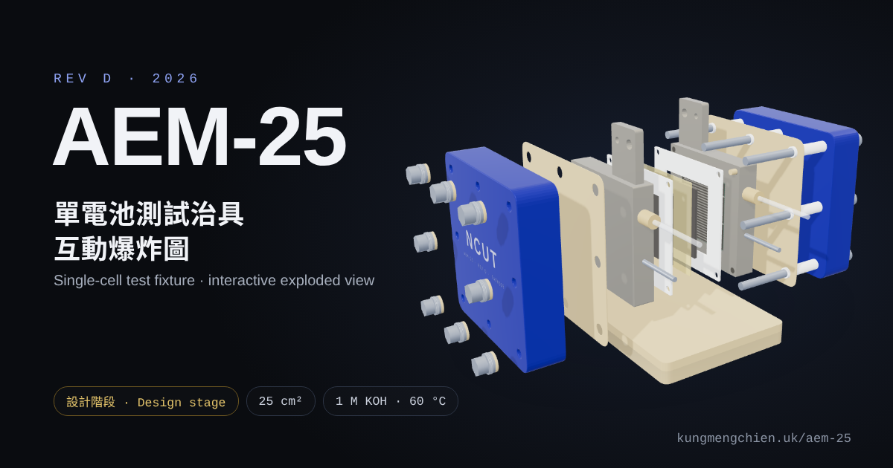

# AEM-25 單電池測試治具 · Single-Cell Test Fixture

**網站 / Live site:** https://kungmengchien.uk/aem-25/



AEM-25 是陰離子交換膜（AEM）水電解用的 25 cm² 單電池測試治具，在 1 M KOH、60 °C 下測一片 MEA。這個網站用互動 3D 爆炸圖介紹 13 個零件群組：拖曳旋轉、拉桿拆開，點任何零件就能看到材料、尺寸和設計理由。

AEM-25 is a 25 cm² single-cell test fixture for anion exchange membrane (AEM) water electrolysis, testing one MEA in 1 M KOH at 60 °C. The site presents its 13 part groups as an interactive 3D exploded view: drag to rotate, slide to take it apart, and click any part for its material, dimensions and design rationale.

> **設計階段 / Design stage.** 治具尚未加工。數字來自 2026-11-06 的 Rev D 設計文件（極耳一左一右、兩片流道左下進右上出、螺栓排成 90 mm 正方形）。The fixture has not been machined yet; figures come from the Rev D design documents dated 2026-11-06 (tabs side by side, both flow fields running lower left to upper right, bolts on a 90 mm square).

## 功能 / Features

- 互動爆炸圖：點選零件、編號標籤或清單，拆開程度可調，可用鍵盤操作
  Interactive exploded view with click-to-inspect, number tags, a parts list, an explode slider and keyboard controls
- 中文／English 切換，預設中文（`?lang=en` 直接開英文）；深色／淺色主題
  Chinese / English toggle, Chinese by default (`?lang=en` opens in English); light / dark themes
- 連結可直接指向零件，例如 `#p=fp_c`
  Deep links to a part, e.g. `#p=fp_c`
- 純靜態網站，不需要建置；three.js 放在 repo 內，不依賴外部 CDN
  Plain static files with no build step; three.js is vendored, no CDN dependency

## 檔案 / Files

| 路徑 Path | 用途 Purpose |
|---|---|
| `index.html` | 頁面、簡介、設計重點、關鍵數字、規格 / Page, intro, design notes, key numbers, specs |
| `assets/js/content.js` | 13 個零件的中英文說明 / Part descriptions (zh / en) |
| `assets/js/app.js` | 3D 模型與互動（尺寸單位 mm）/ 3D model and interaction (dimensions in mm) |
| `assets/js/site.js` | 語言與主題切換 / Language and theme toggles |
| `assets/css/site.css` | 樣式 / Styles |
| `assets/vendor/three/` | three.js r160（MIT） |
| `assets/img/` | 首圖、分享圖、圖示 / Hero, share image, icons |

改數字時，`content.js` 和 `index.html` 的「關鍵數字」「規格」兩段要一起改。
When a figure changes, update `content.js` and the numbers and specs sections in `index.html` together.

Cloudflare 會快取 CSS 和 JS 4 小時，所以改了這些檔案要一起換 `?v=`：`index.html` 三處，`assets/js/app.js` 匯入 `content.js` 一處。
Cloudflare caches CSS and JS for 4 hours, so bump `?v=` whenever they change: three places in `index.html` and the `content.js` import in `assets/js/app.js`.

首圖 `hero.webp` 和分享圖 `og.png` 是 3D 模型的截圖，模型改了要重新產生：在頁面主控台執行 `AEM.snap(寬, 高, 拆開程度)`，會傳回透明背景的圖片網址（首圖用淺色主題截）。圖片也被快取 4 小時，換圖時 `index.html` 的首圖和 `og:image` 兩處 `?v=` 也要一起換。
`hero.webp` and `og.png` are renders of the 3D model, so regenerate them when the model changes: `AEM.snap(width, height, explode)` in the page console returns a transparent-background image URL (render the hero in the light theme). Images are cached for 4 hours too, so bump `?v=` on the hero and `og:image` in `index.html` when they change.

## 本機預覽 / Local preview

```bash
python3 -m http.server 8000
# 開啟 / open http://localhost:8000/
```

直接雙擊 `index.html` 會因為 ES module 的限制無法載入 3D，要用上面的本機伺服器。
Opening `index.html` from the file system will not load the 3D view (ES module restrictions); use a local server.

## 備註 / Notes

- 端板上的 NCUT 是示意字樣，不是國立勤益科技大學的官方標誌。
  The NCUT lettering on the end plate is a placeholder, not the official mark of National Chin-Yi University of Technology.
- 3D 模型由程式依設計尺寸生成；爆炸圖中 MEA 各層有加厚顯示。
  The 3D model is generated in code from the design dimensions; the MEA layers are drawn thicker in the exploded view.
- three.js © three.js authors, MIT License (`assets/vendor/three/LICENSE`).

設計與網站 / Design & site: Meng-Chien Kung（龔孟謙）
